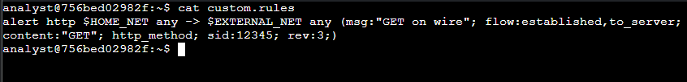
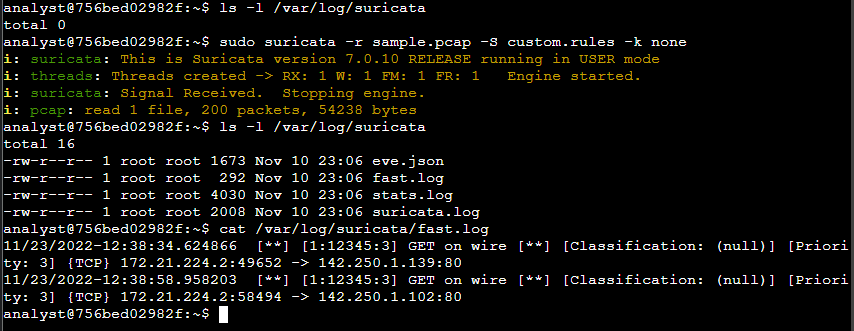
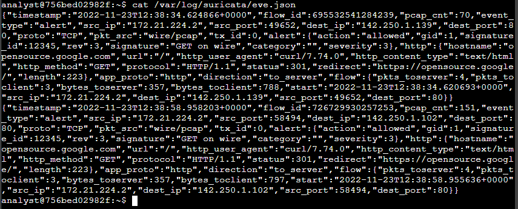
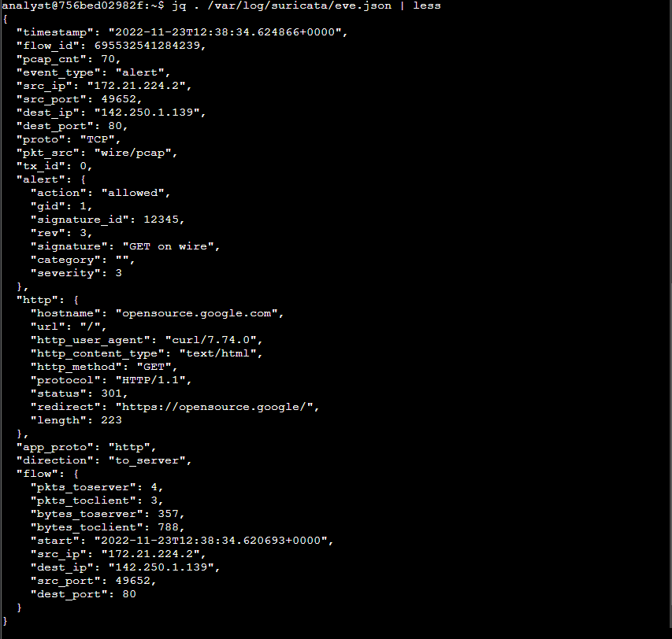
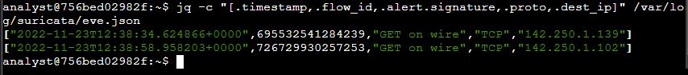
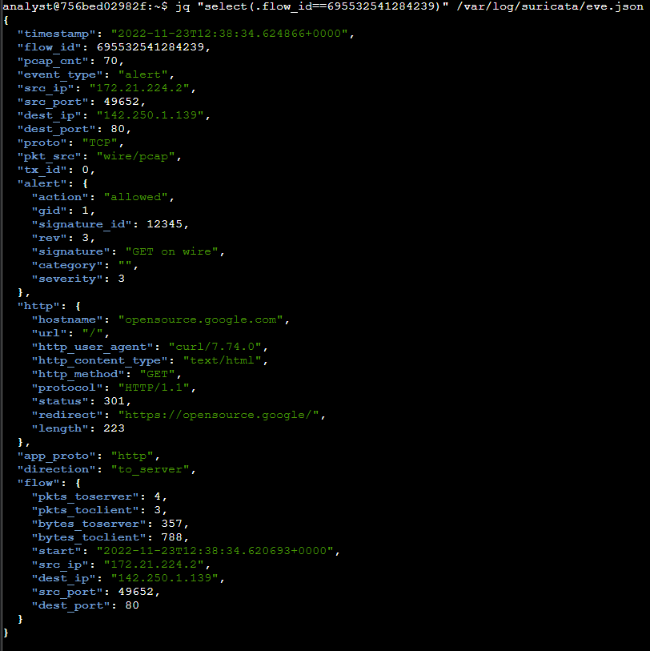

# Suricata Alerts and Logs

## Summary
A guided course lab where I used Suricata, an open-source IDS/IPS, to run a custom rule against a sample packet capture, trigger alerts, and analyze the output in `fast.log` and `eve.json`. I used `jq` to format the JSON log, pull out specific fields, and correlate events by `flow_id`.

## My Role
I worked in the course's Linux lab environment (Bash shell, `analyst` account) with the provided `sample.pcap` and `custom.rules` files. I ran each command, read the logs, answered the lab's questions, and took the screenshots in this repo. The packet capture, rule file, and lab environment were provided by the course; no live network was monitored.

## Project Overview

This project documents a Suricata lab from the Google Cybersecurity Certificate (Sound the Alarm: Detection and Response). The goal was to understand how a Suricata rule is built, trigger it against network traffic, and examine the alerts Suricata generates.

---

## Scenario

As a security analyst monitoring my employer's network, I configured Suricata to process a packet capture with a custom rule and checked whether the rule fired as expected. In this lab, `$HOME_NET` is defined as the `172.21.224.0/20` subnet.

---

## Tools Used

- **Suricata 7.0.10** (IDS/IPS and network analysis tool)
- **jq** (command-line JSON processor)
- Linux CLI (`cat`, `ls -l`, `less`, `sudo`)

---

## The Custom Rule

```
alert http $HOME_NET any -> $EXTERNAL_NET any (msg:"GET on wire"; flow:established,to_server; content:"GET"; http_method; sid:12345; rev:3;)
```

| Part | Value | Meaning |
|---|---|---|
| Action | `alert` | Generate an alert when all conditions match |
| Protocol | `http` | Applies only to HTTP traffic |
| Header | `$HOME_NET any -> $EXTERNAL_NET any` | Traffic from the home network, any port, going to an external network |
| `msg` | `"GET on wire"` | Alert text that explains why the alert fired |
| `flow` | `established,to_server` | Match packets from the client to the server |
| `content` + `http_method` | `"GET"` | Look for GET as the HTTP method |
| `sid` | `12345` | Unique signature ID |
| `rev` | `3` | Revision (version) of the signature |

Other actions covered: `drop` (alert and drop, IPS mode only), `pass` (allow traffic, can override other rules), and `reject` (drop and send a TCP reset). Suricata's default processing order is pass, drop, reject, alert.

---

## Commands Run

| Command | Purpose |
|---|---|
| `cat custom.rules` | Display the custom rule |
| `ls -l /var/log/suricata` | List the log folder before and after running Suricata |
| `sudo suricata -r sample.pcap -S custom.rules -k none` | Process the pcap (`-r`) with the custom rules (`-S`) and checksum checks disabled (`-k none`) |
| `cat /var/log/suricata/fast.log` | Read the quick, one-line alert log |
| `cat /var/log/suricata/eve.json` | Read the raw JSON event log |
| `jq . /var/log/suricata/eve.json \| less` | Pretty-print the JSON log |
| `jq -c "[.timestamp,.flow_id,.alert.signature,.proto,.dest_ip]" /var/log/suricata/eve.json` | Extract specific fields from each event |
| `jq "select(.flow_id==695532541284239)" /var/log/suricata/eve.json` | Show all events for one network flow |

---

## Key Findings

- **Processing:** Suricata read 1 file, **200 packets** (54,238 bytes) and created 4 log files: `eve.json`, `fast.log`, `stats.log`, and `suricata.log`. The folder was empty before the run.
- **Alerts:** The rule fired **twice**, both "GET on wire" (`[1:12345:3]`, Priority 3), from `172.21.224.2` to port 80:
  - `172.21.224.2:49652 -> 142.250.1.139:80`
  - `172.21.224.2:58494 -> 142.250.1.102:80`
- **Severity:** The first alert in `eve.json` has a **severity of 3**, with the action `allowed` (alert only, not dropped).
- **HTTP details from eve.json:** hostname `opensource.google.com`, URL `/`, user agent `curl/7.74.0`, status `301` redirecting to `https://opensource.google/`.
- **Last event's destination IP:** `142.250.1.102`.
- **Flow IDs:** `695532541284239` and `726729930257253`. Selecting the first returned the full alert, HTTP, and flow details (4 packets and 357 bytes to the server, 3 packets and 788 bytes to the client).

---

## Screenshots

### 1. The custom rule (`cat custom.rules`)


### 2. Running Suricata and reading fast.log


### 3. Raw eve.json output


### 4. eve.json formatted with jq


### 5. Extracting specific fields with jq


### 6. All events for one flow_id


---

## Skills Demonstrated

- Reading a Suricata rule's action, header, and rule options
- Running Suricata against a packet capture with a custom rule set
- Validating that a rule triggered by checking `fast.log`
- Analyzing detailed alert and HTTP telemetry in `eve.json`
- Using `jq` to format JSON, extract fields, and filter events
- Correlating events from the same network flow with `flow_id`

---

## What I Learned

- A Suricata signature has three parts: an action, a header, and rule options.
- `fast.log` is good for a quick check that a rule fired, but it's a deprecated format; `eve.json` is the main log for incident response and threat hunting.
- JSON logs are hard to read raw, but `jq` makes them easy to format and query.
- Every network flow gets a unique `flow_id`, which ties together all the events from the same connection.
- Variables like `$HOME_NET` and `$EXTERNAL_NET` are set in `suricata.yaml`, so one rule can work across environments.

---

## Disclaimer

Guided course lab from the Google Cybersecurity Professional Certificate (Coursera). The packet capture, rule file, and Linux lab environment were provided by the course; no live network traffic was captured or monitored. The write-up is my own.

## Certificate
Google Cybersecurity Certificate — Sound the Alarm: Detection and Response
